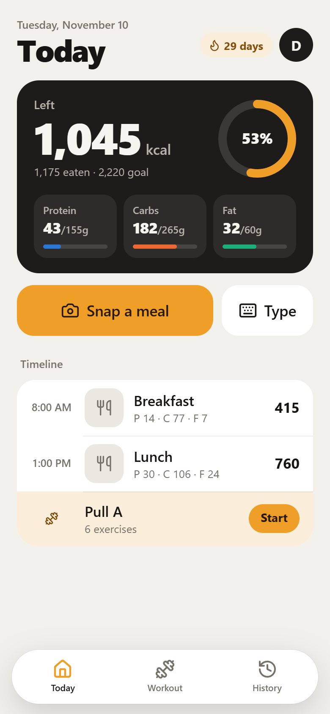
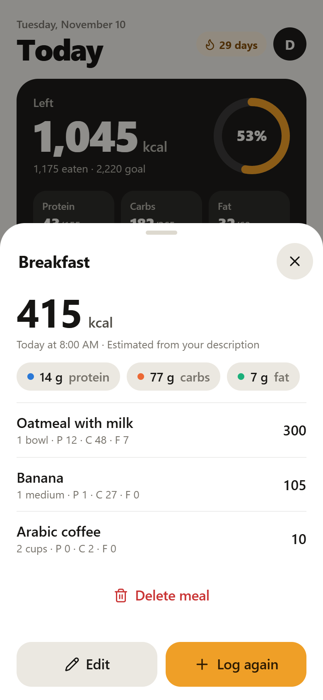
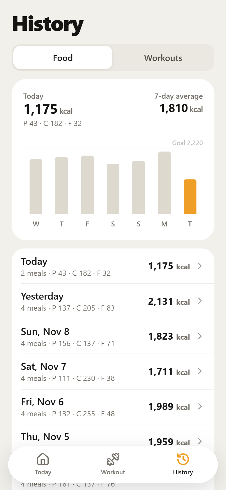
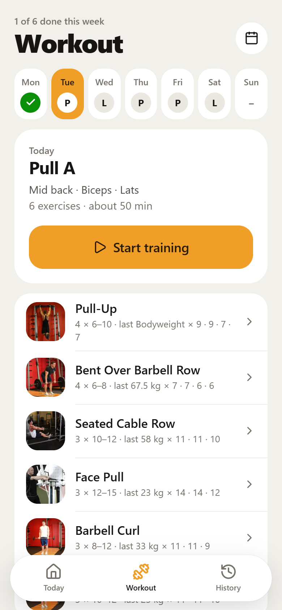
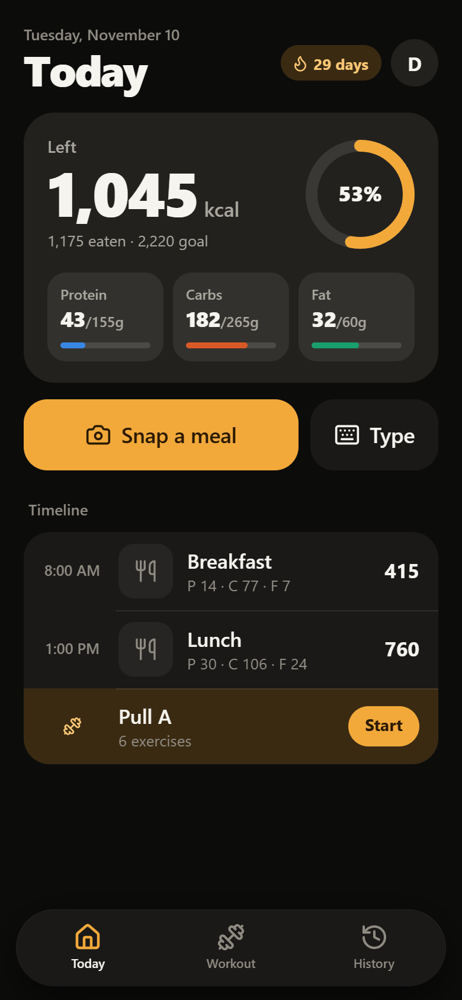

# Plate

**Snap your meal, an AI counts the calories. Log your workout, even with no signal.**
A self-hosted calorie and training tracker made for the iPhone.

**[Try the live demo →](https://n3trunner.dev/plate)** runs in your browser on sample data, no account needed.

<p>
  
  &nbsp;&nbsp;
  
</p>

- **Photo → macros.** Claude, OpenAI or Gemini returns calories, protein, carbs and fat per item. Untick an item,
  change the portion, or tell the AI what to fix.
- **Train from your own plan.** Warm-up for the day's muscles, big steppers for each set, a rest timer, 870+ exercises with photos.
- **Works offline.** Every change is saved on the phone first and synced when the server is reachable.
- **For the whole family.** Each person has their own account; new accounts need an invite code.

<details>
<summary>More screens</summary>
<br>

| Meal | History | Workout | Dark mode |
|---|---|---|---|
|  |  |  |  |

</details>

## Built with

Node.js with no framework and the built-in SQLite · Preact + htm, no build step · one Docker container.
Passwords hashed with scrypt, rate-limited sign-in, a generated service worker, 16 API tests.

**Run it:** `docker compose up -d --build`, then open port 3000. The full guide (Portainer, Cloudflare Tunnel,
iPhone home screen, AI keys, backups) is in **[docs/INSTALL.md](docs/INSTALL.md)**.

## How it is built

```
server/            Node.js, no framework
  index.js         HTTP server and routing between the API and static files
  api.js           every /api route, with input validation
  auth.js          accounts, password hashing (scrypt), sessions, rate limits
  ai.js            the food-estimate prompt and the three providers
  db.js            SQLite schema and helpers
  http.js          static files, security headers, the generated service worker
public/            the app that runs in Safari; plain ES modules, no build step
  js/store.js      app state, the offline queue, sign-in
  js/session.js    the workout-in-progress logic
  js/exercises.js  library search, ready-made plans, warm-up builder
  js/views/        one file per screen
  css/app.css      the whole design
  exercises/       the bundled exercise library (data and photos)
tools/             scripts that produced the bundled library and the icons
test/              automated checks
```

Things worth knowing if you change it:

- **Your phone is the source of truth while you use it.** Every change is applied on the phone,
  saved there, and queued; the queue is sent when the server is reachable. That is why logging
  sets works in a gym with no signal.
- **Weights are stored in kilograms.** Pounds are a display setting.
- **A "day" is the calendar date on the phone**, so daily totals follow your timezone, not the server's.
- **The service worker is generated** by the server from the files in `public/`, so there is no
  list of files or version number to keep up to date by hand.

## Credits

- Exercise data and photos: [free-exercise-db](https://github.com/yuhonas/free-exercise-db) (public domain, The Unlicense).
- Icons: [Lucide](https://lucide.dev) (ISC).
- UI rendering: [Preact](https://preactjs.com) (MIT) and [htm](https://github.com/developit/htm) (Apache-2.0).
- Claude requests use the official [Anthropic SDK](https://github.com/anthropics/anthropic-sdk-typescript) (MIT).

Licence texts for the bundled code are in `public/js/vendor/`.
